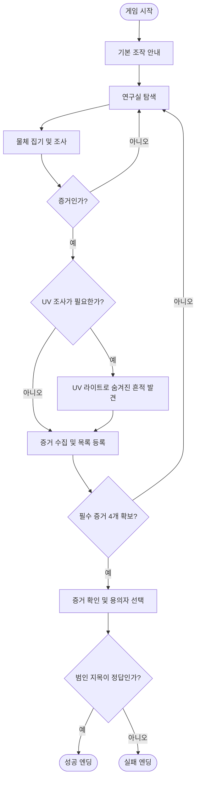

# ROOM 404

### VR Crime Scene Investigation — Lab Ver.

> **대학교 연구실을 배경으로 한 1인용 VR 범죄 수사·추리 게임**  
> 가상현실(VR) 수업 Term Project · 2인 팀 · 개발 기간 4주

**ROOM 404**는 플레이어가 VR 수사관이 되어 대학 연구실의 의문사 사건을 조사하는 게임입니다. 연구실을 탐색하며 증거물을 직접 집어 살펴보고, UV 라이트로 숨겨진 흔적을 찾아 사건의 진상을 추리합니다.

---

## 1. 게임 소개

대학교 연구실에서 한 연구원이 쓰러진 채 발견됩니다. 현장에는 **깨진 커피잔, 약병, 연구자료, 컴퓨터, 메모** 등 여러 흔적이 남아 있지만, 사건은 단순 사고처럼 보입니다.

플레이어는 현장에 투입된 수사관이 되어 연구실 내부를 조사합니다. 물건을 직접 잡아 살펴보고 UV 라이트로 숨겨진 증거를 찾아, **사고로 위장된 타살 사건의 진실**을 밝혀내야 합니다. 확보한 단서를 바탕으로 최종적으로 용의자 중 범인을 지목합니다.

| 항목 | 내용 |
| --- | --- |
| 장르 | 싱글 플레이 VR 수사·추리 게임 |
| 배경 | 대학교 연구실 (단일 범죄 현장) |
| 시점 및 조작 | 1인칭 VR / HMD 및 컨트롤러 |
| 핵심 플레이 | 탐색 → 물체 조사 → 증거 수집 → 추리 |
| 목표 플레이 시간 | 약 5~10분 |
| 개발 규모 | 2인 / 4주 |
| 대상 기기 | Meta Quest 2 |

## 2. 제작 목적

기존 PC 수사·추리 게임의 마우스 클릭 및 키보드 중심 조작에서 벗어나, **VR 공간의 몰입감과 직접적인 오브젝트 상호작용**을 게임의 핵심 경험으로 활용합니다.

- VR 컨트롤러로 증거물과 수사 도구를 직접 조작하는 사용자 경험 구현
- Unity 기반의 VR 이동, 물체 상호작용, UI 및 사건 진행 시스템 학습
- 한정된 연구실 공간 안에서 탐색·수집·추리를 결합한 짧은 완결형 게임 제작

## 3. 주요 기능 (구현 목표)

| 기능 | 설명 |
| --- | --- |
| **VR Locomotion** | 연구실 이동 및 필요 시 Snap Turn / Teleport 활용 |
| **Object Grab** | 증거물과 수사 도구를 직접 집고 내려놓기 |
| **Object Inspection** | 증거물을 손에 들고 회전하며 세부 정보 확인 |
| **UV Evidence Detection** | UV 라이트로 일반 조명에서 보이지 않는 단서 발견 |
| **Evidence Management** | 수집한 증거의 고유 ID 및 조사 상태 관리 |
| **Deduction & Result** | 증거를 바탕으로 용의자 선택 및 성공·실패 엔딩 판정 |
| **VR UI** | 조작 안내, 조사 대상 강조, 증거 목록, 최종 추리 화면 |

### 게임 진행 흐름

## 4. 개발 환경

| 구분 | 기술 및 도구 |
| --- | --- |
| Game Engine | **Unity 6.3 LTS** |
| Language | **C#** |
| XR Runtime | **OpenXR** |
| VR Interaction | **XR Interaction Toolkit** |
| VR HMD | **Meta Quest 2** |
| 3D Assets / Modeling | **Unity Asset Store**, **Autodesk Maya** |
| Version Control | **Git / GitHub** |

> 최종 Unity 에디터 패치 버전, XR 패키지 버전, Quest 2 실행 방식(PC VR / Standalone) 및 빌드 절차는 팀의 초기 환경 설정 후 문서에 확정할 예정입니다.

## 5. 요구사항

### 기능 요구사항 (FR)

| ID | 요구사항 |
| --- | --- |
| FR-01 | VR HMD와 컨트롤러를 통한 연구실 탐색 지원 |
| FR-02 | 조사 가능한 오브젝트 **최소 6개**의 Grab / Release 지원 |
| FR-03 | 증거 수집 시 고유 ID를 증거 목록에 **최초 1회만** 등록 |
| FR-04 | VR 컨트롤러를 통한 UV 라이트 On / Off 지원 |
| FR-05 | UV 라이트가 지정된 영역을 비출 때 숨겨진 단서 표시 |
| FR-06 | **필수 증거 4개** 수집 후 **용의자 3명 중 1명** 선택 허용 |
| FR-07 | 선택한 용의자와 정답을 비교하여 성공 / 실패 엔딩 출력 |

### 비기능 요구사항 (NFR)

| ID | 요구사항 |
| --- | --- |
| NFR-01 | **Motion-to-Photon Delay 15ms 이하**를 목표로 설정 (기기 측정 및 검증 필요) |
| NFR-02 | VR 멀미 감소를 위한 **Teleport / Snap Turn** 등 이동·회전 방식 지원 |
| NFR-03 | 동일 증거에 대한 수집 동작 **10회 반복 시에도** 중복 등록 및 기존 증거 삭제 방지 |

### UI 요구사항 (UI)

| ID | 요구사항 |
| --- | --- |
| UI-01 | 게임 시작 시 **60초 이내에 확인 가능한** 이동·Grab·수집 조작 안내 제공 |
| UI-02 | 조사 가능 오브젝트에 컨트롤러가 **0.2m 이내**로 접근하면 강조 표시 |
| UI-03 | 조사 중인 증거물의 이름과 설명 표시 |
| UI-04 | 신규 증거 수집 후 **2~3초** 동안 완료 알림 표시 |
| UI-05 | 수집 증거의 이름·설명·조사 상태를 목록에서 제공 |
| UI-06 | **용의자 3명**의 정보 표시 및 단일 용의자 선택 |
| UI-07 | 게임 종료 시 성공 / 실패 여부와 사건 결과 설명 제공 |
| UI-08 | 고정형 메뉴 UI의 중심을 기본 시선 기준 **좌우 ±25°, 상하 ±15°**, 눈으로부터 **0.7~1.5m**에 배치 |

## 6. 주차별 개발 계획

| 주차 | 주요 개발 항목 | 목표 결과 |
| --- | --- | --- |
| **1주차** | Unity VR 환경 구축, OpenXR / XR Interaction Toolkit 설정, 이동 및 Grab 구현 | 연구실 공간에서 기본 이동·물체 조작 |
| **2주차** | 연구실 맵 구성, 증거물 배치, Object Inspection, 증거 수집 시스템 | 현장 조사 및 일반 증거 수집 |
| **3주차** | UV / 손전등 기능, 간단한 퍼즐, 사건 진행, 용의자 선택 및 판정 | 게임 시작부터 엔딩까지 플레이 가능 |
| **4주차** | 엔딩 연출, 조명·사운드·그래픽 보완, Quest 2 테스트 및 버그 수정 | 안정화 및 최종 결과물 완성 |

**개발 원칙:** 3주차까지 핵심 게임 플레이를 완성하고, 4주차는 새로운 핵심 기능보다 실기기 검증과 안정화에 집중합니다.

## 7. 팀 구성 및 역할

| 팀원 | 담당 영역 | 주요 업무 |
| --- | --- | --- |
| **김도원** | VR 인터랙션 및 게임 로직 | VR 이동, Grab / Inspection, UV 탐지, Evidence Manager, 결과 판정 |
| **오창엽** | 맵·콘텐츠 및 UI / 연출 | 연구실 맵, 증거물 배치, 증거 UI, 용의자 선택 UI, 조명·사운드·엔딩 연출 |

**공동 작업:** 게임 스토리 작성 및 범죄 트릭 구상

## 8. 실행 안내

현재 저장소는 **제안서 기반 프로젝트 준비 단계**를 기준으로 작성되었습니다. Unity 프로젝트 소스와 실행 가능한 빌드가 추가되면 아래 내용을 업데이트할 예정입니다.

- Unity 프로젝트 가져오기 및 필요한 패키지 설정
- Meta Quest 2 연결 및 실행 방식
- 빌드 및 실행 절차
- VR 컨트롤러 조작법

## 9. 기대 효과

- Unity를 활용한 VR 콘텐츠 개발 과정 경험
- Grab, Inspection, UV 도구 조작 등 VR 특유의 직접 상호작용 구현
- 제한된 공간에서 증거 수집과 추리를 결합하여 몰입감 있는 플레이 경험 제공
- 조명, 사운드, 시각적 단서를 활용하여 플레이어의 시선을 유도하는 VR UX 적용
