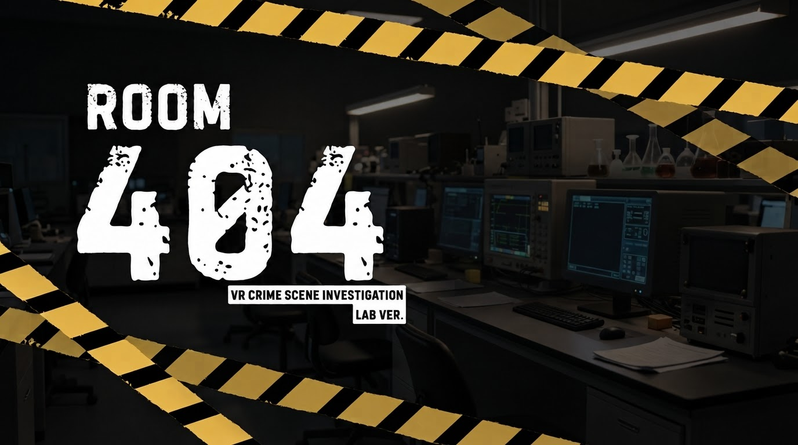
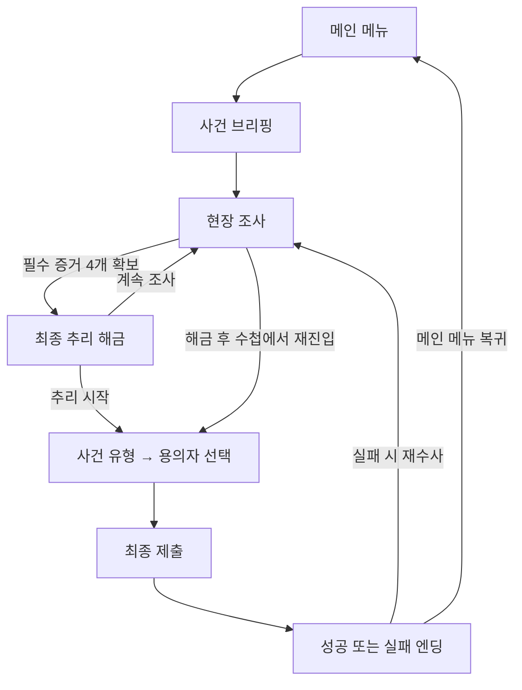

<div align="center">

# ROOM 404

**VR Crime Scene Investigation**

모든 증거가 진실을 말하는 것은 아니다.




</div>

## Project Overview

**ROOM 404**는 대학 연구실의 의문사를 조사하는 1인칭 VR 추리 게임입니다. 수사관이 되어 현장을 탐색하고, 직접 수집한 단서와 용의자의 진술을 대조해 결론을 내립니다.

| 항목 | 내용 |
| --- | --- |
| 장르 | 싱글 플레이 1인칭 VR 미스터리·추리 |
| 개발 인원 | 2인 |
| 콘텐츠 | 연구실 1곳 · 증거 6개 · 용의자 3명 |
| 목표 플레이 시간 | 5~10분 |
| 개발 환경 | Unity 6.3 LTS · C# · OpenXR |

## Story

2026년 10월 29일 밤, 뇌와 인공지능을 연결하는 기술을 연구하던 정하린이 대학 연구실 404호에서 숨진 채 발견됩니다.

과거 임상시험 사고 이후 연구실에는 여러 갈등이 남아 있습니다. 세 용의자가 내놓은 진술을 현장의 단서와 대조하며 그날 밤 무슨 일이 있었는지 밝혀내세요.

## Gameplay

- **VR 현장 탐색** — 연속 이동과 스냅 회전으로 연구실을 돌아다니며 조사할 곳을 찾습니다.
- **Grab과 증거 조사** — 양손으로 물체를 집고 돌려 보며 조사 정보를 확인합니다. 발견한 증거는 Trigger로 수집합니다.
- **UV 손전등** — 일반 조명에서 보이지 않는 흔적을 비춰 발견합니다. 발견한 흔적은 별도로 조사해 수집합니다.
- **형사 수첩** — 사건 개요, 부검 결과, 용의자 알리바이, 수집한 증거의 상세 기록과 추리 메모를 확인합니다.
- **손 애니메이션과 XR UI** — Grip과 Trigger에 따라 손가락이 움직이고, 메뉴에서는 오른손으로 가리켜 버튼을 선택합니다.
- **최종 추리와 엔딩** — 필수 증거 4개를 모으면 사건 유형과 용의자를 선택할 수 있습니다. 제출 결과에 따라 성공·실패 엔딩이 표시되며, 실패 후 재수사할 수 있습니다.

<!-- 실제 게임 스크린샷을 확보하면 이곳에 연구실 탐색, UV 조사, 형사 수첩 장면을 추가합니다. -->
<!-- 실제 시연 영상을 공개하면 이곳에 영상 링크를 추가합니다. -->

## Gameplay Flow



## Tech Stack

| 영역 | 기술 |
| --- | --- |
| 엔진·언어 | Unity 6.3 LTS (`6000.3.15f1`), C# |
| XR | OpenXR `1.16.1`, XR Interaction Toolkit `3.3.2` |
| 입력 | Input System `1.19.0`, XR Interaction Simulator |
| 렌더링·UI | URP `17.3.0`, uGUI, TextMeshPro |

## Getting Started

```bash
git clone https://github.com/dodoria721/ROOM-404-VR-Crime-Scene-Investigation.git
```

1. Unity Hub에서 Unity `6000.3.15f1`을 설치하고 클론한 폴더를 엽니다.
2. 임포트가 끝나면 [MainMenu 씬](Assets/_Project/Scenes/MainMenu.unity)을 엽니다. 현장 조사만 체험하려면 [VR_Test 씬](Assets/_Project/Scenes/VR_Test.unity)을 엽니다.
3. Play를 누르고 Game View에 포커스를 둡니다. XR Interaction Simulator는 자동으로 시작됩니다.

| 동작 | PC XR Interaction Simulator | VR 컨트롤러 입력 |
| --- | --- | --- |
| 조작 대상 선택 | `Tab` 순환 · `[` 왼손 · `]` 오른손 · `H` 헤드 | HMD와 양손을 직접 움직임 |
| 이동·회전 | `I/J/K/L`로 스틱 입력 모사 | 왼쪽 스틱 이동 · 오른쪽 스틱 스냅 회전 |
| 선택한 장치 위치 조작 | `W/A/S/D`, `Q/E` | 장치의 실제 움직임 |
| 물체 집기·고정 증거 선택 | 대상에 손을 가까이 대고 `G` | Grip |
| 수집·UV 전환 | 선택을 유지하고 `T` | 선택을 유지하고 Trigger |
| UI 클릭 | 오른손 Ray로 조준한 뒤 `T` | 오른손 Ray로 조준한 뒤 Trigger |
| 형사 수첩 | `N` | 왼손 `X` |

PC Simulator에서 주요 기능을 테스트한 이력이 있습니다. Meta Quest 2는 목표 기기이며, 현재 저장소에는 Android OpenXR 로더와 Quest 컨트롤러 설정이 필요합니다. Android 빌드와 Quest 2 독립 실행은 미검증 상태이며, 표의 VR 조작은 프로젝트 입력 설정 기준입니다.

## Team & Credits

| 팀원 | 제안서 기준 개발 분담 |
| --- | --- |
| 김도원 | VR 이동·상호작용, 증거 조사·수집, 최종 추리와 결과 판정 |
| 오창엽 | 연구실 맵과 증거 배치, UI, 조명·사운드·엔딩 연출 |
| 공동 | 게임 시나리오와 사건 설계 |

- 본 프로젝트는 가상현실 교과목의 교육용 팀 프로젝트로 제작되었습니다.
- 게임 내 오디오 에셋(BGM, 발소리, 환경음)은 OpenAI ChatGPT를 활용해 제작했습니다.

외부 에셋에는 각 원본 라이선스가 적용됩니다. 저장소 루트에 프로젝트 전체의 별도 라이선스는 명시되어 있지 않습니다. [TextMeshPro 예제의 Roboto 라이선스](Assets/TextMesh%20Pro/Examples%20%26%20Extras/Fonts/Roboto-Bold%20-%20License.txt)
